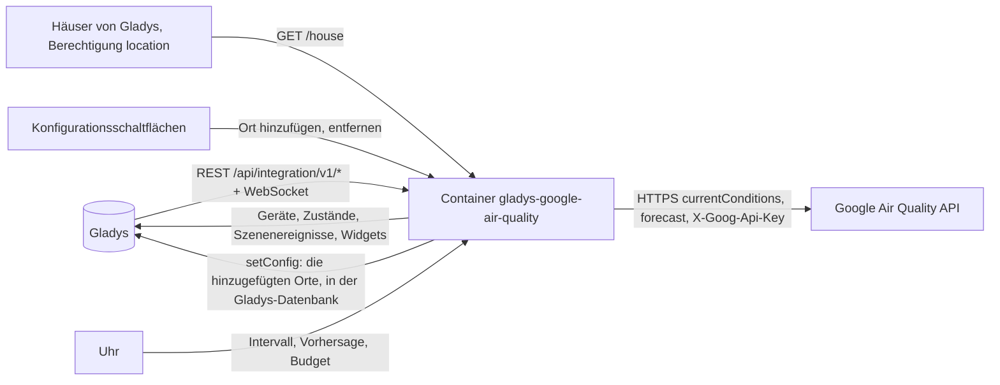
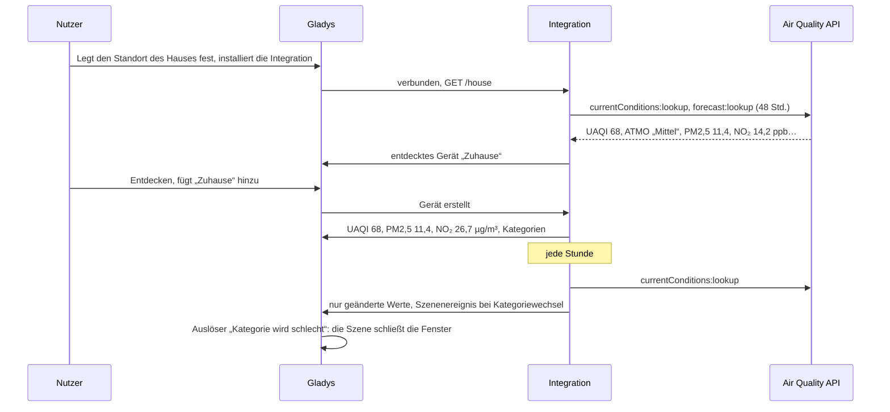
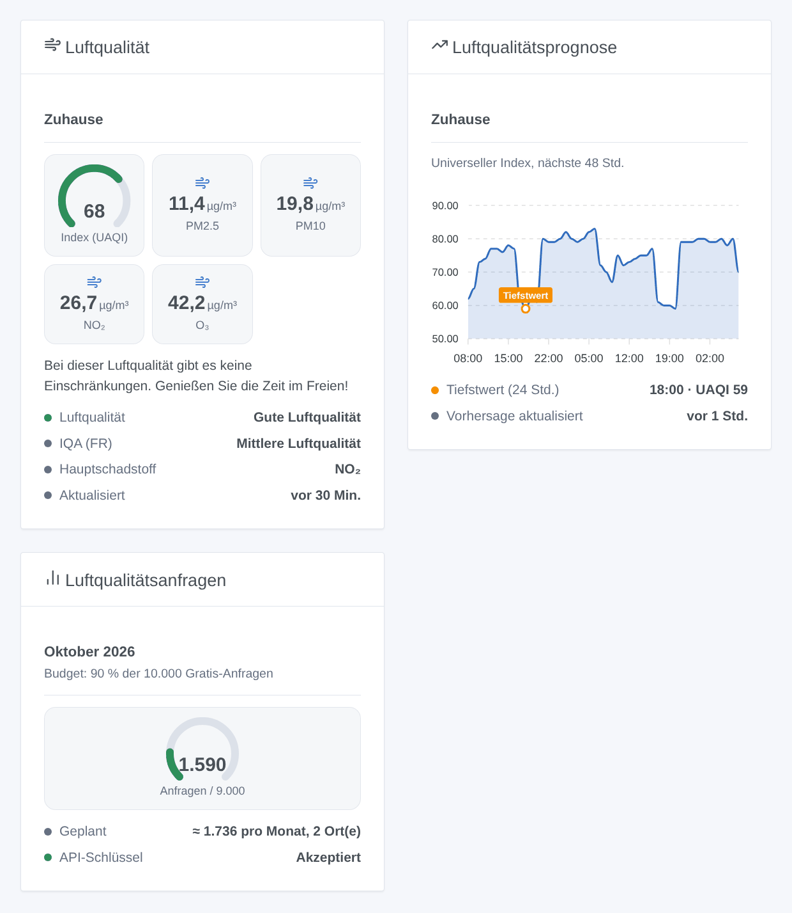

# Gladys Google Air Quality

[English](README.md) · [Français](README.fr.md) · **Deutsch** · [Español](README.es.md)

[](LICENSE)
[](https://github.com/William-De71/gladys-google-air-quality/releases)
[](https://github.com/William-De71/gladys-google-air-quality/actions/workflows/release.yml)
[](https://gladysassistant.com)


Externe Integration für [Gladys Assistant](https://gladysassistant.com), die die Luftqualität der Google Maps Platform für Ihre Häuser und die von Ihnen hinzugefügten Orte liefert: universeller und lokaler Index, PM2,5, PM10, NO₂, O₃, SO₂, eine 48-Stunden-Vorhersage, Szenen und Dashboard-Widgets. Sie nutzt die offizielle Air Quality API mit Ihrem eigenen API-Schlüssel und bleibt standardmäßig im kostenlosen Monatskontingent.

Benutzerdokumentation: [English](docs/en.md) · [Français](docs/fr.md) · [Deutsch](docs/de.md) · [Español](docs/es.md).

Nicht mit Google verbunden. **Noch nicht mit einem echten Google-Maps-Platform-Schlüssel getestet**: Die Anfragen folgen der Dokumentation der Air Quality API, geprüft an ihren echten Fehlerantworten.

## Funktionen

- **Ein Gerät pro Ort**: jedes Haus in Gladys mit Standort und die Orte, die Sie mit Namen und „Breite, Länge“ hinzufügen (Arbeit, Schule, Ferienhaus).
- **Universeller Index** (UAQI, 0-100, je höher, desto besser), der **lokale Index** des Landes (UBA in Deutschland, ATMO in Frankreich, US EPA… oder ein selbst gewählter), **PM2,5, PM10, NO₂, O₃, SO₂** in µg/m³, die Luftqualitätskategorie und der Hauptschadstoff.
- Eine **48-Stunden-Vorhersage** jedes Orts (Diagramm-Widget, Szenenaktion).
- Ein **Monatsbudget**: standardmäßig 90 % der 10.000 kostenlosen Anfragen von Google; die Intervalle werden gestreckt, statt es zu überschreiten.
- **3 Szenenauslöser**, **2 Szenenaktionen** und **3 Dashboard-Widgets** (unten), mit den Gesundheitshinweisen von Google.
- Vier Sprachen überall: Englisch, Französisch, Deutsch, Spanisch.

## Funktionsweise




Von einem Ort zu einer Szene:



### Transport

`transports: ["cloud"]`: Die Luftqualität kommt von Google. **Die Koordinaten Ihrer Orte werden an Google gesendet**, mit Ihrem API-Schlüssel, bei jeder Messung; sonst verlässt nichts Ihr Gladys. Das Lesen der Häuser von Gladys braucht die Berechtigung `location`, die bei der Installation angezeigt wird. Die hinzugefügten Orte werden in der Gladys-Konfiguration gespeichert (und folgen ihren Sicherungen); `/data` hält die letzten Messungen, die letzten Vorhersagen und den Anfragezähler.

## Geräte und Funktionen

| Gerät        | Funktionen (Kategorie / Typ)                                                                                                                                                                                                                                    |
| ------------ | --------------------------------------------------------------------------------------------------------------------------------------------------------------------------------------------------------------------------------------------------------------- |
| Eins pro Ort | Universeller Index (`airquality-sensor` / `aqi`, 0-100), lokaler Index, wenn er eine Zahl ist (`airquality-sensor` / `aqi`), PM2,5, PM10, NO₂, O₃, SO₂ (`pm25-sensor`… / `decimal`, µg/m³), Luftqualität, Kategorie des lokalen Index, Hauptschadstoff (`text`) |

- **Je höher, desto besser** beim universellen Index (100: ausgezeichnete Luft, 0: sehr schlecht). Der lokale Index behält seine Skala (US EPA: je höher, desto schlechter).
- ATMO (Frankreich) und EAQI (Europa) sind Kategorien ohne Zahl: keine Funktion `local_aqi`, nur der Text „Kategorie des lokalen Index“. Wählen Sie später einen anderen lokalen Index, fügt „Aktualisieren“ im Tab Entdecken `local_aqi` hinzu oder entfernt es.
- Google liefert NO₂, O₃ und SO₂ in ppb; sie werden bei 25 °C in µg/m³ umgerechnet (µg/m³ = ppb × Molmasse / 24,45), die Einheit dieser Kategorien in Gladys. CO hat in Gladys keine Konzentrationskategorie: Es erscheint nur in den Ausgaben der Szenenaktion.
- Die externen IDs beruhen auf der ID des Hauses in Gladys oder auf einer zufälligen Kennung eines hinzugefügten Orts, nie auf einem Namen oder Koordinaten.

## Szenenauslöser, Aktionen und Widgets



**Widgets**: Luftqualität (ein Ort: Anzeige des universellen Index nach Stufe gefärbt, lokaler Index, PM2,5, PM10 oder der lokale Index, NO₂, O₃, Kategorien, Hauptschadstoff, Gesundheitshinweis), Luftqualitätsprognose (der universelle Index der nächsten 48 Stunden, die schlechteste Stunde der nächsten 24 markiert), Luftqualitätsanfragen (Anzeige des Monats, das Geplante, der Zustand des Schlüssels). Keine Aktualisieren-Taste: Google aktualisiert die Daten einmal pro Stunde, und jede Anfrage wird berechnet.

**Auslöser** (ein Ereignis pro Übergang, nie als Folge einer Aktion):

- Die Luftqualitätskategorie ändert sich: Bei einer geplanten Messung unterscheidet sich die Kategorie des universellen oder des lokalen Index von der vorigen Messung. Filter: Ort, Index (universell, lokal), neue universelle Stufe (ausgezeichnet, gut, mäßig, schlecht, sehr schlecht). Variablen: Name, Index, Kategorie, vorherige Kategorie, Stufe, vorherige Stufe, Wert, Hauptschadstoff, Zusammenfassung.
- Das Monatsbudget ist fast verbraucht: 80 %, dann 100 %, je einmal pro Monat. Filter: Stufe.
- Google lehnt den API-Schlüssel ab: einmal, bis eine Anfrage wieder funktioniert. Variablen: Grund, Zusammenfassung (mit dem, was zu beheben ist).

Die Werte (UAQI, PM2,5…) sind Gerätefunktionen: „PM2,5 über 25 µg/m³“ ist ein Geräteauslöser von Gladys.

**Aktionen**: die Luftqualität eines Orts lesen (die letzte Messung oder auf Wunsch eine neue: Werte, Kategorien, CO, Gesundheitshinweis, Zusammenfassung); die Vorhersage lesen (die schlechteste Stunde der nächsten 1 bis 48 Stunden: Wert, Stufe, Kategorie, Uhrzeit, Zusammenfassung).

Beispiele:

- Wenn der universelle Index von „Zuhause“ auf „schlecht“ wechselt → die Rollläden schließen und „{{triggerEvent.data.summary}}“ senden.
- Jeden Morgen um 7:00 → die Vorhersage von „Zuhause“ für 12 Stunden lesen → liegt der niedrigste UAQI unter 40, „Kein guter Tag zum Laufen: {{summary}}“ senden.
- Wenn sich der lokale Index von „Schule“ ändert → die Eltern mit der Zusammenfassung benachrichtigen.

## Voraussetzungen

- Gladys Assistant **5.1.0** oder neuer (Widgets und Szenen von Integrationen): Ältere Instanzen können die Integration nicht installieren.
- Ein **Google-Maps-Platform-API-Schlüssel**: ein Google-Cloud-Projekt mit Rechnungskonto (Google verlangt eines auch im Gratiskontingent) und aktivierter **Air Quality API**. Der Schlüssel von Google Weather oder Google Maps Travel Time geht, sobald die Air Quality API in seinem Projekt aktiviert ist.
- Der Standort Ihres Hauses in Gladys (Einstellungen → Häuser) oder mit „Ort hinzufügen“ hinzugefügte Orte.

### Kosten

Google berechnet jede erfolgreiche Anfrage über ein kostenloses Monatskontingent hinaus (Preise geprüft am 2026-10-20):

| SKU                            | Abgerechnetes Ereignis                                        | Gratis pro Monat | Danach, je 1.000 |
| ------------------------------ | ------------------------------------------------------------- | ---------------- | ---------------- |
| Air Quality Usage (Essentials) | eine Anfrage der aktuellen Werte, eine Seite einer Vorhersage | 10.000           | 5 USD            |

Mit den Standardwerten (eine Messung pro Stunde, eine Vorhersage alle 6 Stunden, 48 Stunden auf einer Seite) kostet ein Ort etwa 870 Anfragen im Monat: Zehn Orte passen ins Standardbudget (90 % von 10.000). Darüber hinaus werden beide Intervalle gestreckt. Das Gratiskontingent gilt pro Rechnungskonto: Google Weather, Travel Time oder jede andere Nutzung des Kontos zählen mit; senken Sie das Budget, wenn Sie es teilen.

## Installation

- **Aus dem Store**: Integrationen → Google Air Quality → Installieren.
- **Über die Repository-URL**: Integrationen → externe Integration → `https://github.com/William-De71/gladys-google-air-quality`.
- **Entwicklermodus**: `npm start` mit den von Gladys gelieferten Variablen starten (siehe Entwicklung).

## Konfiguration

| Feld oder Schaltfläche                | Standard    | Bedeutung                                                                            |
| ------------------------------------- | ----------- | ------------------------------------------------------------------------------------ |
| Google-Maps-Platform-API-Schlüssel    | —           | Pflicht, geheim                                                                      |
| Häuser von Gladys verfolgen           | ja          | Ein Ort pro Haus mit Standort                                                        |
| Messung alle                          | 60 Min.     | 30 bis 360; Google aktualisiert die Daten einmal pro Stunde                          |
| Vorhersage alle                       | 6 Std.      | 0 bis 24; 0: keine Vorhersage                                                        |
| Lokaler Index                         | —           | Leer: der Index des Landes; sonst sein Google-Code (`eaqi`, `usa_epa`, `deu_uba`)    |
| Monatsbudget                          | 90 %        | Anteil der 10.000 Gratis-Anfragen; über 100 berechnet Google                         |
| Sprache der Texte                     | automatisch | Funktionsnamen, Kategorien, Gesundheitshinweise, Szenen-Zusammenfassungen, Meldungen |
| Ort hinzufügen / entfernen            | —           | Name und „Breite, Länge“                                                             |
| Orte auflisten / API-Schlüssel testen | —           | Letzte Messung und letzter Fehler jedes Orts; eine Anfrage in Paris                  |

## Verwendung

1. Aktivieren Sie die Air Quality API in Ihrem Google-Cloud-Projekt, fügen Sie Ihren API-Schlüssel ein und drücken Sie **API-Schlüssel testen** (Integrationen → Google Air Quality → Konfiguration).
2. Prüfen Sie, dass Ihr Haus in Gladys einen Standort hat, oder **fügen Sie einen Ort hinzu**; die erste Messung kommt innerhalb einer Minute.
3. **Entdecken**, dann die gewünschten Orte als Geräte hinzufügen.
4. Fügen Sie die Widgets einem Dashboard hinzu und bauen Sie Szenen mit den Gerätefunktionen, Auslösern und Aktionen.

## Entwicklung

```bash
npm install
npm test                       # node --test, nie mit Netzwerk
npm run lint                   # ESLint
npm run format:check           # Prettier
npx github:GladysAssistant/integration-store . --skip-image-check
scripts/build-cover.sh         # cover.jpg aus docs/assets/cover.svg
docs/illustrations/render.sh   # docs/assets/widgets.<lang>.png
```

Lokal liest das SDK `GLADYS_HOST_API_URL`, `GLADYS_INTEGRATION_TOKEN` und `GLADYS_INTEGRATION_SELECTOR` (von Gladys im Entwicklermodus geliefert), die Integration liest `TZ`. `DEBUG=gladys-integration-sdk` zeigt die SDK-Logs.

Die Tests decken den Client der Air Quality API ab (Body, Header, lokaler Index, Vorhersageseiten, Fehler, Zählung), die Messungen (Stufen, Umrechnungen, schlechteste Stunde), den Monatsplan, die Orte (Koordinaten, Register, Häuser), die Geräte (die Felder, die der Entdecken-Bildschirm verlangt), die Widgets (`validateWidgetContent`), die Szenenereignisse und Ausgaben, die Uhr (Intervall, Neustart, abgelehnter Schlüssel, 429, Budget), das Manifest, die vier Sprachen, das Release-Skript und die ganze Integration gegen das Fake-Gladys des SDK und ein Fake-fetch. `test/structure.test.js` friert alle Schlüssel ein, die Nutzer speichern.

## Release-Prozess


Jeder Merge auf `main` startet die CI und berechnet dann die Version aus den [Conventional Commits](https://www.conventionalcommits.org/) seit dem letzten Tag: `feat` → Minor, `fix` / `perf` → Patch, `!` oder `BREAKING CHANGE` → Major (ein Minor vor 1.0.0); `docs`, `chore`, `ci`, `test`, `style`, `refactor`, `build` allein veröffentlichen nichts. Der Changelog-Abschnitt wird erzeugt, das Tag gepusht, das Multi-Arch-Image gebaut, dann erhält `main` den Release-Commit, das GitHub-Release wird erstellt und ein letzter Job prüft das öffentliche Image, den Store-Validator und das Topic.

- Der Titel des Pull Requests wird zum Squash-Commit, dann zur Changelog-Zeile: auf Englisch, für den Nutzer (`pr-title.yml` prüft ihn). `CHANGELOG.md` nie von Hand ändern.
- 1.0.0 ist eine Entscheidung: Actions → Release → Run workflow mit `release-as: 1.0.0`. `dry-run` zeigt Version und Notizen, ohne zu veröffentlichen.
- **Geschützter Branch**: Das Release pusht seinen Commit mit `GITHUB_TOKEN` auf `main`. Das Ruleset `protect-main` (kein Löschen, kein Force-Push) lässt es durch; eine strengere Regel (Pull Request Pflicht, Status Checks) bräuchte GitHub Actions in der Bypass-Liste oder eine GitHub App.
- Nach dem ersten Release das `ghcr.io`-Paket öffentlich machen (Package settings → Change visibility), sonst kann Gladys es nicht laden.

## Fehlerbehebung

Siehe [docs/de.md](docs/de.md#fehlerbehebung). Melden Sie Probleme mit den Versionen von Gladys und der Integration, dem Ergebnis von „Orte auflisten“ und den Logs der Integration. Fügen Sie nie Ihren API-Schlüssel ein.

## Mitwirken

Issues und Pull Requests sind willkommen. Führen Sie vor einem Pull Request `npm run format:check && npm run lint && npm test` aus und lassen Sie alle externen IDs und gespeicherten Schlüssel unverändert (siehe [CLAUDE.md](CLAUDE.md)).

## Sicherheit

Siehe [SECURITY.md](SECURITY.md): Schwachstellen vertraulich melden. Der API-Schlüssel ist ein `secret`-Feld: nie geloggt, nie in `/data` geschrieben, nur an `airquality.googleapis.com` in einem Header gesendet. Die Koordinaten werden nie geloggt.

## Screenshots folgen

Die Bilder oben sind Illustrationen, keine Screenshots. Echte Screenshots kommen nach `docs/assets/screenshots/` (PNG, 1280 × 800): `configuration.png`, `discovery.png`, `device.png` (ein Ort mit seinen Funktionen), `scene.png` (der Auslöser „Kategorie ändert sich“).

## Lizenz

[Apache License 2.0](LICENSE) — siehe auch [NOTICE](NOTICE). Google Maps ist eine Marke von Google LLC. Dank an die Dokumentation und das SDK von Gladys und an die Home-Assistant-Integration Google Air Quality für ihren Umfang. Die **Pollen**-API von Google gehört nicht dazu: Andere Integrationen decken Pollen ab.
