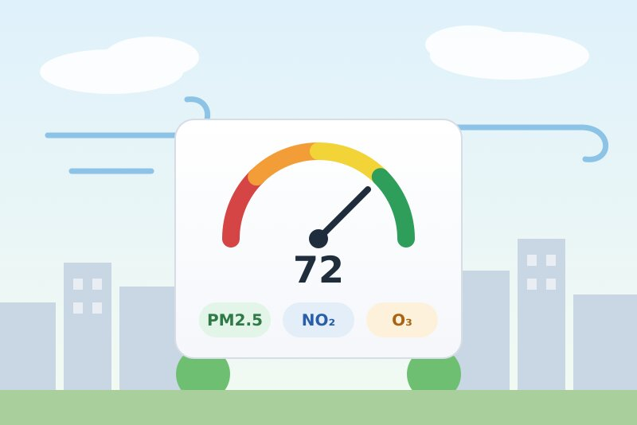
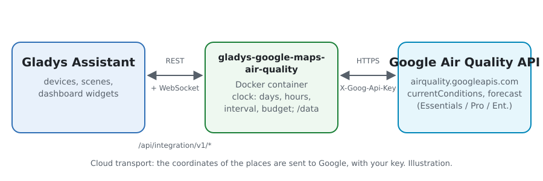
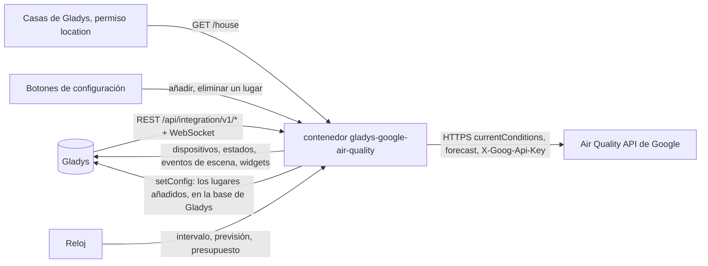
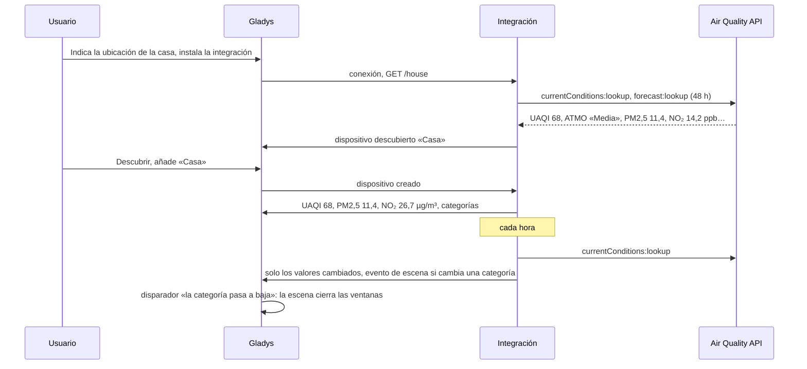
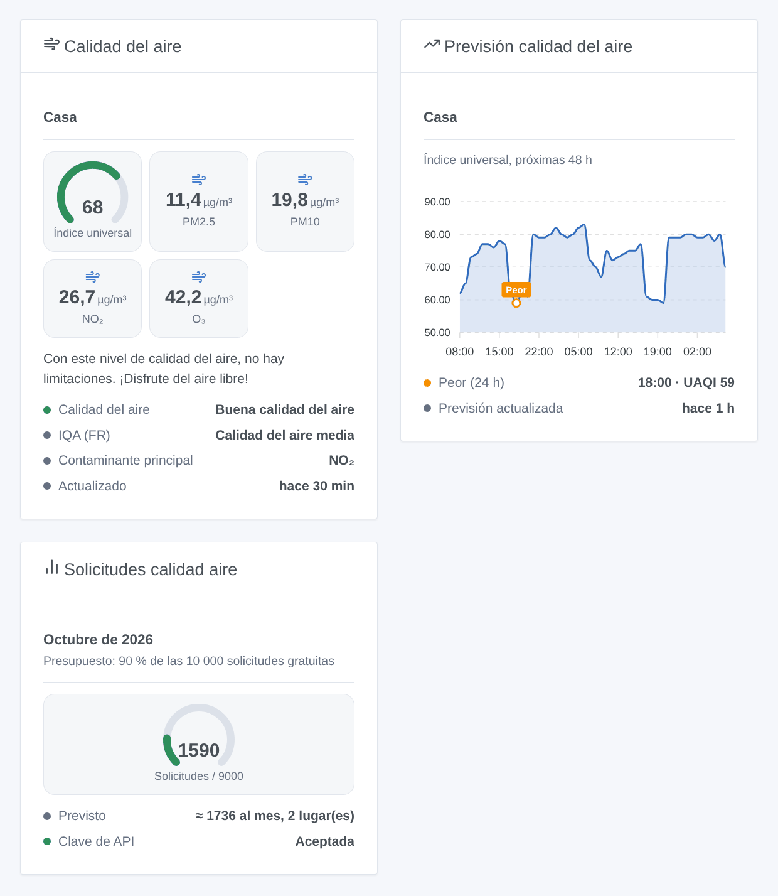

# Gladys Google Air Quality

[English](README.md) · [Français](README.fr.md) · [Deutsch](README.de.md) · **Español**

[](LICENSE)
[](https://github.com/William-De71/gladys-google-air-quality/releases)
[](https://github.com/William-De71/gladys-google-air-quality/actions/workflows/release.yml)
[](https://gladysassistant.com)



Integración externa para [Gladys Assistant](https://gladysassistant.com) que lleva la calidad del aire de Google Maps Platform a sus casas y a los lugares que añada: índices universal y local, PM2,5, PM10, NO₂, O₃, SO₂, previsión a 48 horas, escenas y widgets de panel. Usa la Air Quality API oficial con su propia clave de API y, por defecto, se queda dentro del uso mensual gratuito.

Documentación de usuario: [English](docs/en.md) · [Français](docs/fr.md) · [Deutsch](docs/de.md) · [Español](docs/es.md).

Sin relación con Google. **Aún no probada con una clave real de Google Maps Platform**: las solicitudes siguen la documentación de la Air Quality API, comprobada con sus respuestas de error reales.

## Funciones

- **Un dispositivo por lugar**: cada casa de Gladys con ubicación, y los lugares que añada con un nombre y «latitud, longitud» (trabajo, colegio, casa de vacaciones).
- **Índice universal** (UAQI, 0-100, cuanto más alto, mejor), el **índice local** del país (MITECO en España, ATMO en Francia, US EPA…, o el que elija), **PM2,5, PM10, NO₂, O₃, SO₂** en µg/m³, la categoría de calidad del aire y el contaminante principal.
- Una **previsión a 48 horas** de cada lugar (widget de gráfico, acción de escena).
- Un **presupuesto mensual**: el 90 % de las 10 000 solicitudes gratuitas de Google por defecto; los intervalos se alargan antes que superarlo.
- **3 disparadores de escena**, **2 acciones de escena** y **3 widgets** (abajo), con los consejos de salud de Google.
- Cuatro idiomas en todas partes: inglés, francés, alemán, español.

## Funcionamiento





De un lugar a una escena:



### Transporte

`transports: ["cloud"]`: la calidad del aire viene de Google. **Las coordenadas de sus lugares se envían a Google** con su clave de API, en cada medida; nada más sale de su Gladys. Leer las casas de Gladys necesita el permiso `location`, mostrado al instalar. Los lugares añadidos se guardan en la configuración de Gladys (y siguen sus copias de seguridad); `/data` guarda las últimas medidas, las últimas previsiones y el contador de solicitudes.

## Dispositivos y funciones

| Dispositivo   | Funciones (categoría / tipo)                                                                                                                                                                                                                                        |
| ------------- | ------------------------------------------------------------------------------------------------------------------------------------------------------------------------------------------------------------------------------------------------------------------- |
| Uno por lugar | Índice universal (`airquality-sensor` / `aqi`, 0-100), índice local cuando es un número (`airquality-sensor` / `aqi`), PM2,5, PM10, NO₂, O₃, SO₂ (`pm25-sensor`… / `decimal`, µg/m³), calidad del aire, categoría del índice local, contaminante principal (`text`) |

- **Cuanto más alto, mejor** para el índice universal (100: aire excelente, 0: malo). El índice local conserva su escala (US EPA: cuanto más alto, peor).
- ATMO (Francia) y EAQI (Europa) son categorías sin número: no tienen función `local_aqi`, solo el texto «categoría del índice local». Si elige más tarde otro índice local, «Actualizar» en la pestaña Descubrir añade o quita `local_aqi`.
- Google da NO₂, O₃ y SO₂ en ppb; se convierten a µg/m³ a 25 °C (µg/m³ = ppb × masa molar / 24,45), la unidad de estas categorías en Gladys. El CO no tiene categoría de concentración en Gladys: solo aparece en las salidas de la acción de escena.
- Los identificadores externos se basan en el id de la casa en Gladys, o en un identificador aleatorio dado a un lugar añadido, nunca en un nombre ni en coordenadas.

## Disparadores, acciones de escena y widgets



**Widgets**: Calidad del aire (un lugar: indicador del índice universal coloreado según el nivel, índice local, PM2,5, PM10 o el índice local, NO₂, O₃, categorías, contaminante principal, consejo de salud), Previsión calidad del aire (el índice universal de las próximas 48 horas, la peor hora de las próximas 24 marcada), Solicitudes calidad aire (indicador del mes, lo previsto, el estado de la clave). Sin botón de actualizar: Google actualiza los datos una vez por hora y cada solicitud se factura.

**Disparadores** (un evento por transición, nunca como consecuencia de una acción):

- La categoría de calidad del aire cambia: en una medida programada, la categoría del índice universal o del índice local difiere de la medida anterior. Filtros: lugar, índice (universal, local), nuevo nivel universal (excelente, buena, moderada, baja, mala). Variables: nombre, índice, categoría, categoría anterior, nivel, nivel anterior, valor, contaminante principal, resumen.
- El presupuesto del mes está casi gastado: 80 %, luego 100 %, una vez cada uno al mes. Filtro: nivel.
- Google rechaza la clave de API: una vez, hasta que una solicitud vuelva a funcionar. Variables: motivo, resumen (con lo que hay que corregir).

Los valores (UAQI, PM2,5…) son funciones del dispositivo: «PM2,5 por encima de 25 µg/m³» es un disparador de dispositivo de Gladys.

**Acciones**: leer la calidad del aire de un lugar (la última medida, o una nueva si se pide: valores, categorías, CO, consejo de salud, frase de resumen); leer la previsión (la peor hora de las próximas 1 a 48 horas: valor, nivel, categoría, hora, resumen).

Ejemplos:

- Cuando el índice universal de «Casa» pasa a «baja» → bajar las persianas y enviar «{{triggerEvent.data.summary}}».
- Cada mañana a las 7:00 → leer la previsión de «Casa» a 12 horas → si el UAQI más bajo está por debajo de 40, enviar «No es buen día para correr: {{summary}}».
- Cuando cambia el índice local de «Colegio» → avisar a los padres con el resumen.

## Requisitos

- Gladys Assistant **5.3.0** o posterior (widgets y escenas de integraciones, palabras clave del catálogo de Gladys 5.3): las instancias más antiguas no pueden instalar la integración.
- Una **clave de API de Google Maps Platform**: un proyecto de Google Cloud con una cuenta de facturación (Google la pide incluso en el uso gratuito) y la **Air Quality API** activada. La clave de Google Weather o de Google Maps Travel Time sirve una vez activada la Air Quality API en su proyecto.
- La ubicación de su casa indicada en Gladys (Ajustes → Casas), o lugares añadidos con «Añadir un lugar».

### Coste

Google factura cada solicitud correcta más allá de un uso mensual gratuito (precios comprobados el 2026-10-20):

| SKU                            | Evento facturado                                               | Gratis al mes | Después, por 1000 |
| ------------------------------ | -------------------------------------------------------------- | ------------- | ----------------- |
| Air Quality Usage (Essentials) | una solicitud de condiciones actuales, una página de previsión | 10 000        | 5 USD             |

Con los valores por defecto (una medida por hora, una previsión cada 6 horas, 48 horas en una página), un lugar cuesta unas 870 solicitudes al mes: diez lugares caben en el presupuesto por defecto (90 % de 10 000). Más allá, los dos intervalos se alargan. El uso gratuito es por cuenta de facturación: Google Weather, Travel Time o cualquier otro uso de la cuenta cuentan también; baje el presupuesto si la comparte.

## Instalación

- **Desde la tienda**: Integraciones → Google Air Quality → Instalar.
- **Desde la URL del repositorio**: Integraciones → integración externa → `https://github.com/William-De71/gladys-google-air-quality`.
- **Modo desarrollador**: ejecute `npm start` con las variables que da Gladys (ver Desarrollo).

## Configuración

| Campo o botón                        | Por defecto | Significado                                                                          |
| ------------------------------------ | ----------- | ------------------------------------------------------------------------------------ |
| Clave de API de Google Maps Platform | —           | Obligatoria, secreta                                                                 |
| Seguir las casas de Gladys           | sí          | Un lugar por cada casa con ubicación                                                 |
| Medida cada                          | 60 min      | 30 a 360; Google actualiza los datos una vez por hora                                |
| Previsión cada                       | 6 h         | 0 a 24; 0: sin previsión                                                             |
| Índice local                         | —           | Vacío: el índice del país; si no, su código de Google (`eaqi`, `usa_epa`, `deu_uba`) |
| Presupuesto mensual                  | 90 %        | Parte de las 10 000 solicitudes gratuitas; por encima de 100, Google factura         |
| Idioma de los textos                 | automático  | Nombres de funciones, categorías, consejos de salud, resúmenes de escenas, mensajes  |
| Añadir / Eliminar un lugar           | —           | Nombre y «latitud, longitud»                                                         |
| Listar los lugares / Probar la clave | —           | Última medida y último error de cada lugar; una solicitud en París                   |

## Uso

1. Active la Air Quality API en su proyecto de Google Cloud, pegue su clave de API y pulse **Probar la clave de API** (Integraciones → Google Air Quality → Configuración).
2. Compruebe que su casa tiene ubicación en Gladys, o **Añada un lugar**; la primera medida llega en menos de un minuto.
3. **Descubrir**, luego añada los lugares que quiera como dispositivos.
4. Añada los widgets a un panel y cree escenas con las funciones del dispositivo, los disparadores y las acciones.

## Desarrollo

```bash
npm install
npm test                       # node --test, nunca usa la red
npm run lint                   # ESLint
npm run format:check           # Prettier
npx github:GladysAssistant/integration-store . --skip-image-check
scripts/build-cover.sh         # cover.jpg desde docs/assets/cover.svg
docs/illustrations/render.sh   # docs/assets/widgets.<lang>.png
```

En local, el SDK lee `GLADYS_HOST_API_URL`, `GLADYS_INTEGRATION_TOKEN` y `GLADYS_INTEGRATION_SELECTOR` (dadas por Gladys en modo desarrollador), y la integración lee `TZ`. `DEBUG=gladys-integration-sdk` muestra los registros del SDK.

Las pruebas cubren el cliente de la Air Quality API (cuerpo, cabecera, índice local, páginas de previsión, errores, recuento), las medidas (niveles, conversiones, peor hora), el plan mensual, los lugares (coordenadas, registro, casas), los dispositivos (los campos que exige la pantalla Descubrir), los widgets (`validateWidgetContent`), los eventos y salidas de escena, el reloj (intervalo, reinicio, clave rechazada, 429, presupuesto), el manifiesto, los cuatro idiomas, el script de release y la integración completa frente al Gladys falso del SDK y un fetch falso. `test/structure.test.js` congela todas las claves que guardan los usuarios.

## Proceso de release


Cada fusión en `main` lanza la CI y calcula la versión a partir de los [Conventional Commits](https://www.conventionalcommits.org/) desde la última etiqueta: `feat` → menor, `fix` / `perf` → parche, `!` o `BREAKING CHANGE` → mayor (una menor antes de 1.0.0); `docs`, `chore`, `ci`, `test`, `style`, `refactor`, `build` solos no publican nada. Se genera la sección del changelog, se sube la etiqueta, se construye la imagen multiarquitectura, luego `main` recibe el commit de release, se crea la GitHub Release y un último job comprueba la imagen pública, el validador de la tienda y el topic.

- El título del pull request se convierte en el commit squash y luego en la línea del changelog: escríbalo en inglés, para el usuario (`pr-title.yml` lo comprueba). No edite nunca `CHANGELOG.md` a mano.
- 1.0.0 es una decisión: Actions → Release → Run workflow con `release-as: 1.0.0`. `dry-run` muestra la versión y las notas sin publicar.
- **Rama protegida**: la release sube su commit a `main` con `GITHUB_TOKEN`. El ruleset `protect-main` (sin borrado ni force-push) lo deja pasar; una regla más estricta (pull request obligatorio, status checks) necesitaría GitHub Actions en su lista de omisión, o una GitHub App.
- Tras la primera release, haga público el paquete `ghcr.io` (Package settings → Change visibility), o Gladys no podrá descargarlo.

## Solución de problemas

Vea [docs/es.md](docs/es.md#solución-de-problemas). Informe de los problemas con las versiones de Gladys y de la integración, el resultado de «Listar los lugares» y los registros de la integración. No pegue nunca su clave de API.

## Contribuir

Issues y pull requests bienvenidos. Ejecute `npm run format:check && npm run lint && npm test` antes de abrir un pull request y mantenga sin cambios todos los identificadores externos y claves guardadas (ver [CLAUDE.md](CLAUDE.md)).

## Seguridad

Vea [SECURITY.md](SECURITY.md): informe de las vulnerabilidades en privado. La clave de API es un campo `secret`: nunca registrada, nunca escrita en `/data`, enviada solo a `airquality.googleapis.com` en una cabecera. Las coordenadas nunca se registran.

## Capturas por venir

Las imágenes de arriba son ilustraciones, no capturas de pantalla. Las capturas reales irán en `docs/assets/screenshots/` (PNG, 1280 × 800): `configuration.png`, `discovery.png`, `device.png` (un lugar con sus funciones), `scene.png` (el disparador «la categoría cambia»).

## Licencia

[Apache License 2.0](LICENSE) — ver también [NOTICE](NOTICE). Google Maps es una marca de Google LLC. Gracias a la documentación y al SDK de Gladys, y a la integración Google Air Quality de Home Assistant por su alcance. La API **Pollen** de Google queda fuera del alcance: otras integraciones cubren el polen.
