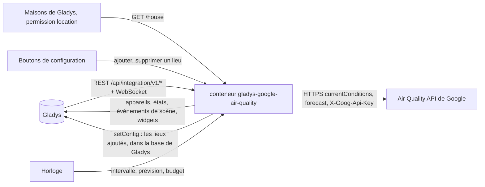
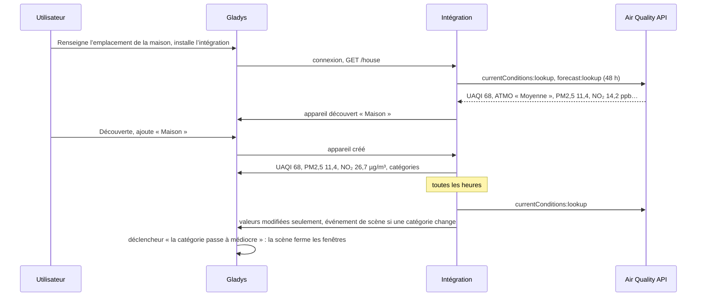
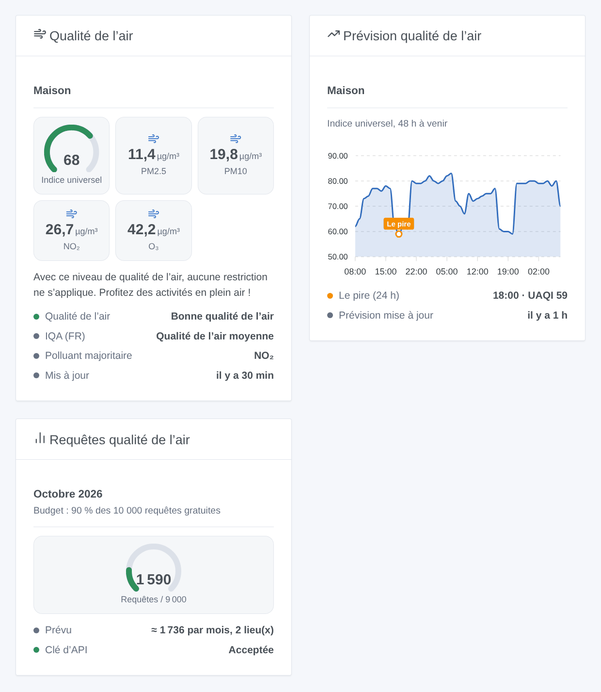

# Gladys Google Air Quality

[English](README.md) · **Français** · [Deutsch](README.de.md) · [Español](README.es.md)

[](LICENSE)
[](https://github.com/William-De71/gladys-google-air-quality/releases)
[](https://github.com/William-De71/gladys-google-air-quality/actions/workflows/release.yml)
[](https://gladysassistant.com)


Intégration externe pour [Gladys Assistant](https://gladysassistant.com) qui apporte la qualité de l’air de Google Maps Platform à vos maisons et aux lieux que vous ajoutez : indices universel et local, PM2,5, PM10, NO₂, O₃, SO₂, prévision sur 48 heures, scènes et widgets de tableau de bord. Elle utilise l’Air Quality API officielle avec votre propre clé d’API, et reste par défaut dans l’usage mensuel gratuit.

Documentation utilisateur : [English](docs/en.md) · [Français](docs/fr.md) · [Deutsch](docs/de.md) · [Español](docs/es.md).

Non affiliée à Google. **Pas encore testée avec une vraie clé Google Maps Platform** : les requêtes suivent la documentation de l’Air Quality API, vérifiée sur ses vraies réponses d’erreur.

## Fonctionnalités

- **Un appareil par lieu** : chaque maison de Gladys dont l’emplacement est renseigné, et les lieux que vous ajoutez avec un nom et « latitude, longitude » (travail, école, maison de vacances).
- **Indice universel** (UAQI, 0-100, plus il est haut, meilleur est l’air), **indice local** du pays (ATMO en France, UBA en Allemagne, US EPA…, ou celui de votre choix), **PM2,5, PM10, NO₂, O₃, SO₂** en µg/m³, catégorie de qualité de l’air et polluant majoritaire.
- Une **prévision sur 48 heures** de chaque lieu (widget graphique, action de scène).
- Un **budget mensuel** : 90 % des 10 000 requêtes gratuites de Google par défaut ; les intervalles s’allongent plutôt que de le dépasser.
- **3 déclencheurs de scène**, **2 actions de scène** et **3 widgets** (ci-dessous), avec les conseils santé de Google.
- Quatre langues partout : anglais, français, allemand, espagnol.

## Fonctionnement




D’un lieu à une scène :



### Transport

`transports: ["cloud"]` : la qualité de l’air vient de Google. **Les coordonnées de vos lieux sont envoyées à Google** avec votre clé d’API, à chaque mesure ; rien d’autre ne quitte votre Gladys. La lecture des maisons de Gladys demande la permission `location`, affichée à l’installation. Les lieux ajoutés sont stockés dans la configuration de Gladys (et suivent ses sauvegardes) ; `/data` garde les dernières mesures, les dernières prévisions et le compteur de requêtes.

## Appareils et fonctionnalités

| Appareil    | Fonctionnalités (catégorie / type)                                                                                                                                                                                                                              |
| ----------- | --------------------------------------------------------------------------------------------------------------------------------------------------------------------------------------------------------------------------------------------------------------- |
| Un par lieu | Indice universel (`airquality-sensor` / `aqi`, 0-100), indice local s’il est chiffré (`airquality-sensor` / `aqi`), PM2,5, PM10, NO₂, O₃, SO₂ (`pm25-sensor`… / `decimal`, µg/m³), qualité de l’air, catégorie de l’indice local, polluant majoritaire (`text`) |

- **Plus il est haut, meilleur est l’air** pour l’indice universel (100 : excellent, 0 : mauvais). L’indice local garde son échelle (US EPA : plus il est haut, pire c’est).
- ATMO (France) et EAQI (Europe) sont des catégories sans chiffre : pas de fonctionnalité `local_aqi`, seulement le texte « catégorie de l’indice local ». Si vous choisissez plus tard un autre indice local, « Mettre à jour » dans l’onglet Découverte ajoute ou retire `local_aqi`.
- Google donne NO₂, O₃ et SO₂ en ppb ; ils sont convertis en µg/m³ à 25 °C (µg/m³ = ppb × masse molaire / 24,45), l’unité de ces catégories dans Gladys. Le CO n’a pas de catégorie de concentration dans Gladys : il n’apparaît que dans les sorties de l’action de scène.
- Les identifiants externes reposent sur l’identifiant de la maison dans Gladys, ou sur un identifiant aléatoire donné à un lieu ajouté, jamais sur un nom ni sur des coordonnées.

## Déclencheurs, actions de scène et widgets



**Widgets** : Qualité de l’air (un lieu : jauge de l’indice universel colorée selon le niveau, indice local, PM2,5, PM10 ou l’indice local, NO₂, O₃, catégories, polluant majoritaire, conseil santé), Prévision qualité de l’air (l’indice universel des 48 prochaines heures, l’heure la moins bonne des 24 suivantes marquée), Requêtes qualité de l’air (jauge du mois, le prévu, l’état de la clé). Pas de bouton d’actualisation : Google met à jour ses données une fois par heure et chaque requête est facturée.

**Déclencheurs** (un événement par transition, jamais en conséquence d’une action) :

- La catégorie de qualité de l’air change : lors d’une mesure planifiée, la catégorie de l’indice universel ou de l’indice local diffère de la mesure précédente. Filtres : lieu, indice (universel, local), nouveau niveau universel (excellent, bon, moyen, médiocre, mauvais). Variables : nom, indice, catégorie, catégorie précédente, niveau, niveau précédent, valeur, polluant majoritaire, résumé.
- Le budget du mois est presque utilisé : 80 %, puis 100 %, une fois chacun par mois. Filtre : niveau.
- Google refuse la clé d’API : une fois, jusqu’à ce qu’une requête fonctionne de nouveau. Variables : raison, résumé (avec ce qu’il faut corriger).

Les valeurs (UAQI, PM2,5…) sont des fonctionnalités d’appareil : « PM2,5 au-dessus de 25 µg/m³ » est un déclencheur d’appareil de Gladys.

**Actions** : lire la qualité de l’air d’un lieu (la dernière mesure, ou une nouvelle sur demande : valeurs, catégories, CO, conseil santé, phrase de résumé) ; lire la prévision (l’heure la moins bonne des 1 à 48 prochaines heures : valeur, niveau, catégorie, heure, résumé).

Exemples :

- Quand l’indice universel de « Maison » passe à « médiocre » → fermer les volets et envoyer « {{triggerEvent.data.summary}} ».
- Chaque matin à 7 h → lire la prévision de « Maison » sur 12 heures → si l’UAQI le plus bas est sous 40, envoyer « Pas idéal pour courir : {{summary}} ».
- Quand l’indice local de « École » change → prévenir les parents avec le résumé.

## Prérequis

- Gladys Assistant **5.1.0** ou plus récent (widgets et scènes des intégrations) : les instances plus anciennes ne peuvent pas installer l’intégration.
- Une **clé d’API Google Maps Platform** : un projet Google Cloud avec un compte de facturation (Google en demande un même dans l’usage gratuit) et l’**Air Quality API** activée. La clé de Google Weather ou de Google Maps Travel Time convient une fois l’Air Quality API activée dans son projet.
- L’emplacement de votre maison renseigné dans Gladys (Paramètres → Maisons), ou des lieux ajoutés avec « Ajouter un lieu ».

### Coût

Google facture chaque requête réussie au-delà d’un usage mensuel gratuit (tarifs vérifiés le 2026-10-20) :

| SKU                            | Événement facturé                                          | Gratuit par mois | Ensuite, les 1 000 |
| ------------------------------ | ---------------------------------------------------------- | ---------------- | ------------------ |
| Air Quality Usage (Essentials) | une requête de conditions actuelles, une page de prévision | 10 000           | 5 USD              |

Avec les réglages par défaut (une mesure par heure, une prévision toutes les 6 heures, 48 heures en une page), un lieu coûte environ 870 requêtes par mois : dix lieux tiennent dans le budget par défaut (90 % de 10 000). Au-delà, les deux intervalles s’allongent. L’usage gratuit est par compte de facturation : Google Weather, Travel Time ou tout autre usage du compte comptent aussi, baissez le budget si vous le partagez.

## Installation

- **Depuis le store** : Intégrations → Google Air Quality → Installer.
- **Depuis l’URL du dépôt** : Intégrations → intégration externe → `https://github.com/William-De71/gladys-google-air-quality`.
- **Mode développeur** : lancez `npm start` avec les variables fournies par Gladys (voir Développement).

## Configuration

| Champ ou bouton                  | Défaut      | Rôle                                                                               |
| -------------------------------- | ----------- | ---------------------------------------------------------------------------------- |
| Clé d’API Google Maps Platform   | —           | Obligatoire, secrète                                                               |
| Suivre les maisons de Gladys     | oui         | Un lieu par maison dont l’emplacement est renseigné                                |
| Mesure toutes les                | 60 min      | 30 à 360 ; Google met à jour ses données une fois par heure                        |
| Prévision toutes les             | 6 h         | 0 à 24 ; 0 : pas de prévision                                                      |
| Indice local                     | —           | Vide : l’indice du pays ; sinon son code Google (`eaqi`, `usa_epa`, `deu_uba`)     |
| Budget mensuel                   | 90 %        | Part des 10 000 requêtes gratuites ; au-delà de 100, Google facture                |
| Langue des textes                | automatique | Noms des fonctionnalités, catégories, conseils santé, résumés des scènes, messages |
| Ajouter / Supprimer un lieu      | —           | Nom et « latitude, longitude »                                                     |
| Lister les lieux / Tester la clé | —           | Dernière mesure et dernière erreur de chaque lieu ; une requête à Paris            |

## Utilisation

1. Activez l’Air Quality API dans votre projet Google Cloud, collez votre clé d’API, puis appuyez sur **Tester la clé d’API** (Intégrations → Google Air Quality → Configuration).
2. Vérifiez que votre maison a un emplacement dans Gladys, ou **Ajoutez un lieu** ; la première mesure arrive dans la minute.
3. **Découverte**, puis ajoutez les lieux voulus comme appareils.
4. Ajoutez les widgets à un tableau de bord, et créez des scènes avec les fonctionnalités, les déclencheurs et les actions.

## Développement

```bash
npm install
npm test                       # node --test, ne touche jamais le réseau
npm run lint                   # ESLint
npm run format:check           # Prettier
npx github:GladysAssistant/integration-store . --skip-image-check
scripts/build-cover.sh         # cover.jpg depuis docs/assets/cover.svg
docs/illustrations/render.sh   # docs/assets/widgets.<lang>.png
```

En local, le SDK lit `GLADYS_HOST_API_URL`, `GLADYS_INTEGRATION_TOKEN` et `GLADYS_INTEGRATION_SELECTOR` (fournies par Gladys en mode développeur), et l’intégration lit `TZ`. `DEBUG=gladys-integration-sdk` affiche les journaux du SDK.

Les tests couvrent le client de l’Air Quality API (corps, en-tête, indice local, pages de prévision, erreurs, comptage), les mesures (niveaux, conversions, pire heure), le plan mensuel, les lieux (coordonnées, registre, maisons), les appareils (les champs qu’exige l’écran Découverte), les widgets (`validateWidgetContent`), les événements et sorties de scène, l’horloge (intervalle, redémarrage, clé refusée, 429, budget), le manifeste, les quatre langues, le script de release, et l’intégration entière face au faux Gladys du SDK et à un faux fetch. `test/structure.test.js` fige toutes les clés que les utilisateurs stockent.

## Processus de release


Chaque fusion sur `main` lance la CI, puis calcule la version d’après les [Conventional Commits](https://www.conventionalcommits.org/) depuis le dernier tag : `feat` → mineure, `fix` / `perf` → correctif, `!` ou `BREAKING CHANGE` → majeure (une mineure avant 1.0.0) ; `docs`, `chore`, `ci`, `test`, `style`, `refactor`, `build` seuls ne publient rien. La section du changelog est générée, le tag poussé, l’image multi-architecture construite, puis `main` reçoit le commit de release, la GitHub Release est créée et un dernier job vérifie l’image publique, le validateur du store et le topic.

- Le titre de la pull request devient le commit squash, puis la ligne du changelog : écrivez-le en anglais, pour l’utilisateur (`pr-title.yml` le vérifie). Ne modifiez jamais `CHANGELOG.md` à la main.
- 1.0.0 est une décision : Actions → Release → Run workflow avec `release-as: 1.0.0`. `dry-run` affiche la version et les notes sans rien publier.
- **Branche protégée** : la release pousse son commit sur `main` avec `GITHUB_TOKEN`. Le ruleset `protect-main` (ni suppression ni force-push) le laisse passer ; une règle plus stricte (pull request obligatoire, status checks) demanderait GitHub Actions dans sa liste de contournement, ou une GitHub App.
- Après la première release, rendez le package `ghcr.io` public (Package settings → Change visibility), sinon Gladys ne peut pas le télécharger.

## Dépannage

Voir [docs/fr.md](docs/fr.md#dépannage). Signalez un problème avec les versions de Gladys et de l’intégration, le résultat de « Lister les lieux » et les journaux de l’intégration. Ne collez jamais votre clé d’API.

## Contribuer

Issues et pull requests bienvenues. Lancez `npm run format:check && npm run lint && npm test` avant d’ouvrir une pull request, et gardez inchangés tous les identifiants externes et clés stockées (voir [CLAUDE.md](CLAUDE.md)).

## Sécurité

Voir [SECURITY.md](SECURITY.md) : signalez les vulnérabilités en privé. La clé d’API est un champ `secret` : jamais journalisée, jamais écrite dans `/data`, envoyée seulement à `airquality.googleapis.com` dans un en-tête. Les coordonnées ne sont jamais journalisées.

## Captures à venir

Les images ci-dessus sont des illustrations, pas des captures d’écran. Les vraies captures iront dans `docs/assets/screenshots/` (PNG, 1280 × 800) : `configuration.png`, `discovery.png`, `device.png` (un lieu et ses fonctionnalités), `scene.png` (le déclencheur « la catégorie change »).

## Licence

[Apache License 2.0](LICENSE) — voir aussi [NOTICE](NOTICE). Google Maps est une marque de Google LLC. Merci à la documentation et au SDK de Gladys, et à l’intégration Home Assistant Google Air Quality pour son périmètre. L’API **Pollen** de Google est hors périmètre : d’autres intégrations couvrent le pollen.
