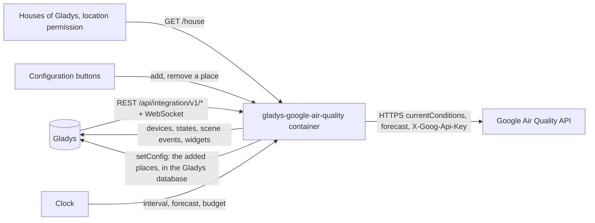
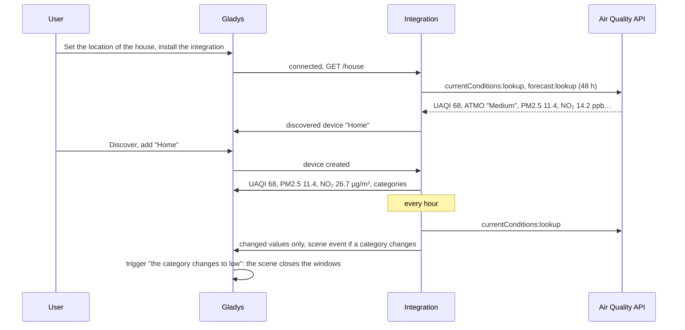
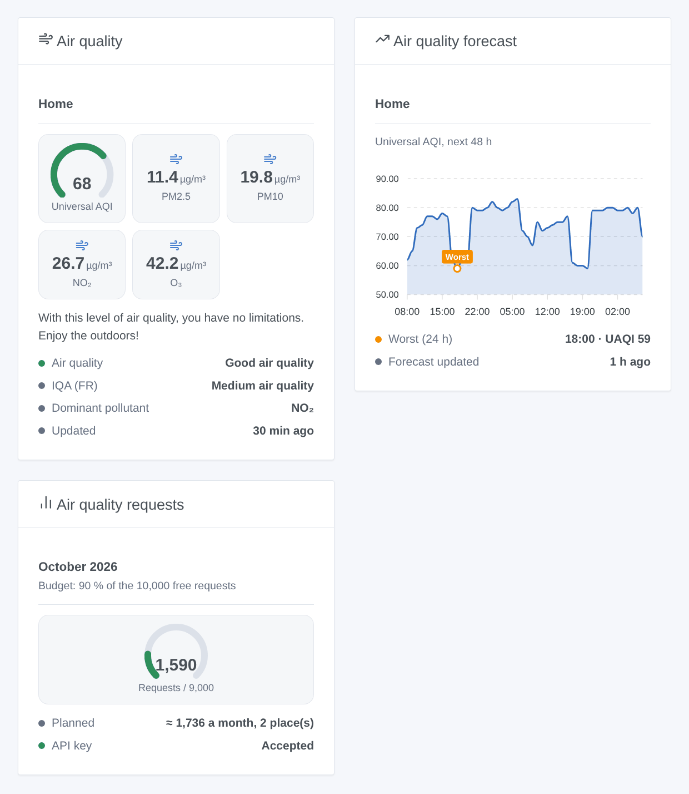

# Gladys Google Air Quality

**English** · [Français](README.fr.md) · [Deutsch](README.de.md) · [Español](README.es.md)

[](LICENSE)
[](https://github.com/William-De71/gladys-google-air-quality/releases)
[](https://github.com/William-De71/gladys-google-air-quality/actions/workflows/release.yml)
[](https://gladysassistant.com)


[Gladys Assistant](https://gladysassistant.com) external integration that brings the air quality of Google Maps Platform to your houses and to the places you add: universal and local indexes, PM2.5, PM10, NO₂, O₃, SO₂, a 48-hour forecast, scenes and dashboard widgets. It uses the official Air Quality API with your own API key, and keeps its requests within the free monthly usage by default.

User documentation: [English](docs/en.md) · [Français](docs/fr.md) · [Deutsch](docs/de.md) · [Español](docs/es.md).

Not affiliated with Google. **Not tested with a real Google Maps Platform key yet**: the requests follow the documentation of the Air Quality API, checked against its real error answers.

## Features

- **One device per place**: every house of Gladys with a location, and the places you add with a name and "latitude, longitude" (work, school, holiday home).
- **Universal AQI** (0-100, higher is better), the **local index** of the country (ATMO in France, UBA in Germany, US EPA…, or the one you choose), **PM2.5, PM10, NO₂, O₃, SO₂** in µg/m³, the air quality category and the dominant pollutant.
- A **48-hour forecast** of each place (chart widget, scene action).
- A **monthly budget**: 90 % of Google's 10,000 free requests by default; the intervals are stretched rather than going over.
- **3 scene triggers**, **2 scene actions** and **3 dashboard widgets** (below), with Google's health advice.
- Four languages everywhere: English, French, German, Spanish.

## How it works




From a place to a scene:



### Transport

`transports: ["cloud"]`: the air quality comes from Google. **The coordinates of your places are sent to Google** with your API key, at each reading; nothing else leaves your Gladys. Reading the houses of Gladys needs the `location` permission, shown on the install screen. The added places are stored in the Gladys configuration (and follow its backups); `/data` keeps the last readings, the last forecasts and the request counter.

## Devices and features

| Device        | Features (category / type)                                                                                                                                                                                                                       |
| ------------- | ------------------------------------------------------------------------------------------------------------------------------------------------------------------------------------------------------------------------------------------------ |
| One per place | Universal AQI (`airquality-sensor` / `aqi`, 0-100), local index when it is a number (`airquality-sensor` / `aqi`), PM2.5, PM10, NO₂, O₃, SO₂ (`pm25-sensor`… / `decimal`, µg/m³), air quality, local index category, dominant pollutant (`text`) |

- **Higher is better** for the universal AQI (100: excellent air, 0: poor). The local index keeps its own scale (US EPA: higher is worse).
- ATMO (France) and EAQI (Europe) are categories without a number: they have no `local_aqi` feature, only the "local index category" text. If you choose another local index later, "Update" on the Discover tab adds or removes `local_aqi`.
- Google gives NO₂, O₃ and SO₂ in ppb; they are converted to µg/m³ at 25 °C (µg/m³ = ppb × molar mass / 24.45), the unit of these categories in Gladys. CO has no concentration category in Gladys: it is shown in the scene action outputs only.
- External ids rest on the id of the house in Gladys, or on a random identifier given to an added place, never on a name nor on coordinates.

## Scene triggers, actions and widgets



**Widgets**: Air quality (one place: universal AQI gauge colored by level, local index, PM2.5, PM10 or the local index, NO₂, O₃, categories, dominant pollutant, health advice), Air quality forecast (the universal AQI of the next 48 hours, the worst hour of the next 24 marked), Air quality requests (gauge of the month, the plan, the state of the key). No refresh button: Google updates the data once an hour and every request is billed.

**Triggers** (one event per transition, never as the result of an action):

- The air quality category changes: at a scheduled reading, the category of the universal AQI or of the local index differs from the previous reading. Filters: place, index (universal, local), new universal level (excellent, good, moderate, low, poor). Variables: name, index, category, previous category, level, previous level, value, dominant pollutant, summary.
- The monthly budget is almost used: 80 %, then 100 %, once each per month. Filter: level.
- Google refuses the API key: once, until a request works again. Variables: reason, summary (with what to fix).

The values (UAQI, PM2.5…) are device features: "PM2.5 above 25 µg/m³" is a device trigger of Gladys.

**Actions**: read the air quality of a place (the last reading, or a new one when asked: values, categories, CO, health advice, summary sentence); read the forecast (the worst hour of the next 1 to 48 hours: value, level, category, hour, summary).

Examples:

- When the universal AQI of "Home" changes to "low" → close the roller shutters and send "{{triggerEvent.data.summary}}".
- Every morning at 7:00 → read the forecast of "Home" for 12 hours → if the lowest UAQI is under 40, send "Not a good day for a run: {{summary}}".
- When the local index of "School" changes → notify the parents with the summary.

## Requirements

- Gladys Assistant **5.3.0** or later (widgets and scenes of integrations, catalog keywords of Gladys 5.3): older instances cannot install the integration.
- A **Google Maps Platform API key**: a Google Cloud project with a billing account (Google asks for one even within the free usage) and the **Air Quality API** enabled. The key of Google Weather or Google Maps Travel Time works once the Air Quality API is enabled in its project.
- The location of your house set in Gladys (Settings → Houses), or places added with "Add a place".

### Cost

Google bills every successful request beyond a free monthly usage (pricing checked on 2026-10-20):

| SKU                            | Billable event                                       | Free a month | Then, per 1,000 |
| ------------------------------ | ---------------------------------------------------- | ------------ | --------------- |
| Air Quality Usage (Essentials) | a current-conditions request, one page of a forecast | 10,000       | 5 USD           |

With the defaults (a reading every hour, a forecast every 6 hours, 48 hours in one page), a place costs about 870 requests a month: ten places fit in the default budget (90 % of 10,000). Beyond, both intervals are stretched. The free usage is per billing account: Google Weather, Travel Time or any other use of the account count too, lower the budget if you share it.

## Installation

- **From the store**: Integrations → Google Air Quality → Install.
- **From the repository URL**: Integrations → external integration → `https://github.com/William-De71/gladys-google-air-quality`.
- **Developer mode**: run `npm start` with the variables given by Gladys (see Development).

## Configuration

| Field or button                    | Default   | Meaning                                                                              |
| ---------------------------------- | --------- | ------------------------------------------------------------------------------------ |
| Google Maps Platform API key       | —         | Required, a secret                                                                   |
| Follow the houses of Gladys        | yes       | One place per house with a location                                                  |
| Reading every                      | 60 min    | 30 to 360; Google updates the data once an hour                                      |
| Forecast every                     | 6 h       | 0 to 24; 0: no forecast                                                              |
| Local index                        | —         | Empty: the index of the country; else its Google code (`eaqi`, `usa_epa`, `deu_uba`) |
| Monthly budget                     | 90 %      | Share of the 10,000 free requests; above 100, Google bills                           |
| Language of the texts              | automatic | Feature names, categories, health advice, scene summaries, button messages           |
| Add / Remove a place               | —         | Name and "latitude, longitude"                                                       |
| List the places / Test the API key | —         | Last reading and last error of each place; one request in Paris                      |

## Usage

1. Enable the Air Quality API in your Google Cloud project, paste your API key, then press **Test the API key** (Integrations → Google Air Quality → Configuration).
2. Check that your house has a location in Gladys, or **Add a place**; the first reading comes within a minute.
3. **Discover**, then add the places you want as devices.
4. Add the widgets to a dashboard, and build scenes with the device features, the triggers and the actions.

## Development

```bash
npm install
npm test                       # node --test, never touches the network
npm run lint                   # ESLint
npm run format:check           # Prettier
npx github:GladysAssistant/integration-store . --skip-image-check
scripts/build-cover.sh         # cover.jpg from docs/assets/cover.svg
docs/illustrations/render.sh   # docs/assets/widgets.<lang>.png
```

Locally, the SDK reads `GLADYS_HOST_API_URL`, `GLADYS_INTEGRATION_TOKEN` and `GLADYS_INTEGRATION_SELECTOR` (given by Gladys in developer mode), and the integration reads `TZ`. `DEBUG=gladys-integration-sdk` shows the SDK logs.

The tests cover the Air Quality API client (body, header, local index, forecast pages, errors, billing count), the readings (levels, conversions, worst hour), the monthly plan, the places (coordinates, registry, houses), the devices (the fields the Discovery screen requires), the widgets (`validateWidgetContent`), the scene events and outputs, the clock (interval, restart, refused key, 429, budget), the manifest, the four languages, the release script, and the whole integration against the fake Gladys of the SDK and a fake fetch. `test/structure.test.js` freezes every key users store.

## Release process


Every merge on `main` runs the CI, then computes the version from the [Conventional Commits](https://www.conventionalcommits.org/) since the last tag: `feat` → minor, `fix` / `perf` → patch, `!` or `BREAKING CHANGE` → major (a minor below 1.0.0); `docs`, `chore`, `ci`, `test`, `style`, `refactor`, `build` alone publish nothing. The changelog section is generated, the tag pushed, the multi-architecture image built, then `main` receives the release commit, the GitHub Release is created and a last job checks the public image, the store validator and the topic.

- The pull request title becomes the squash commit, then the changelog line: write it in English, for the user (`pr-title.yml` checks it). Never edit `CHANGELOG.md` by hand.
- 1.0.0 is a decision: Actions → Release → Run workflow with `release-as: 1.0.0`. `dry-run` shows the version and the notes without publishing.
- **Protected branch**: the release pushes its commit to `main` with `GITHUB_TOKEN`. The `protect-main` ruleset (no deletion, no force-push) lets it through; a stricter rule (pull request required, status checks) would need GitHub Actions in its bypass list, or a GitHub App.
- After the first release, make the `ghcr.io` package public (Package settings → Change visibility), or Gladys cannot pull it.

## Troubleshooting

See [docs/en.md](docs/en.md#troubleshooting). Report issues with the versions of Gladys and of the integration, the result of "List the places" and the logs of the integration. Never paste your API key.

## Contributing

Issues and pull requests are welcome. Run `npm run format:check && npm run lint && npm test` before opening a pull request, and keep every external id and stored key unchanged (see [CLAUDE.md](CLAUDE.md)).

## Security

See [SECURITY.md](SECURITY.md): report vulnerabilities privately. The API key is a `secret` field: never logged, never written to `/data`, sent only to `airquality.googleapis.com` in a header. The coordinates are never logged.

## Screenshots to come

The images above are illustrations, not screenshots. Real screenshots will go in `docs/assets/screenshots/` (PNG, 1280 × 800): `configuration.png`, `discovery.png`, `device.png` (a place with its features), `scene.png` (the "category changes" trigger).

## License

[Apache License 2.0](LICENSE) — see also [NOTICE](NOTICE). Google Maps is a trademark of Google LLC. Thanks to the Gladys documentation and SDK, and to the Home Assistant Google Air Quality integration for its scope. The Google **Pollen** API is out of scope: other integrations cover pollen.
